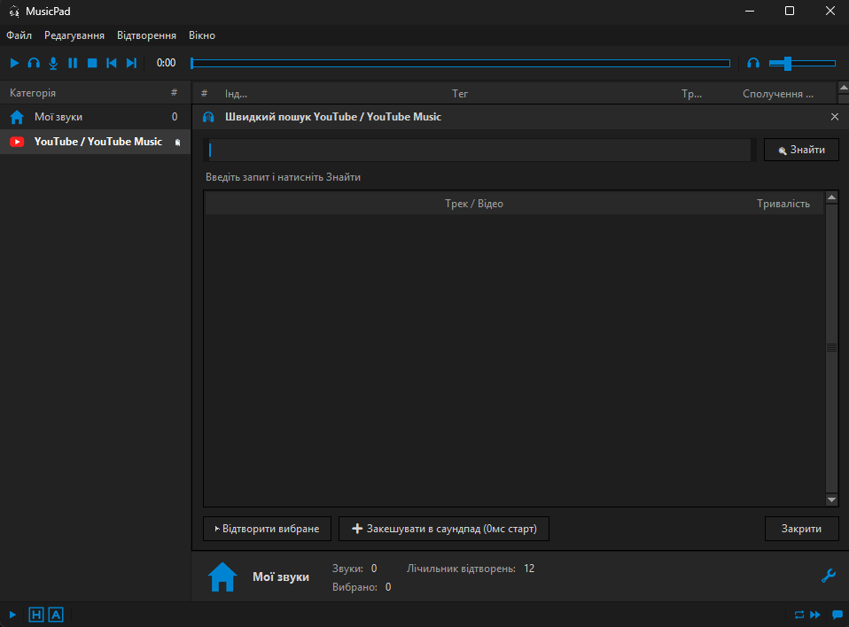

# MusicPad



MusicPad — Windows desktop-програвач, який відтворює локальну музику або транслює
YouTube Music у вибраний аудіовихід. Для VB-Audio Virtual Cable обирайте пристрій
`CABLE Input`: інші програми побачать цей сигнал через `CABLE Output` як мікрофон.

## Швидкий запуск (для користувачів)

1. Завантажте **`MusicPad.exe`** (або ZIP-архів) зі сторінки [**GitHub Releases**](../../releases/latest).
2. Запустіть файл — додаток працює одразу **«з коробки»**. Жодних додаткових компонентів (включно з FFmpeg) встановлювати не потрібно, FFmpeg уже вшито всередину виконуваного файлу.
3. **Примітка щодо VB-Audio Virtual Cable**: якщо ви бажаєте транслювати звук у голосовий чат (Discord, Telegram, Zoom, ігри тощо), вам знадобиться безкоштовний віртуальний кабель [VB-Audio Virtual Cable](https://vb-audio.com/Cable/).

## Запуск із вихідного коду (для розробників)

1. Встановіть Python 3.10+ та FFmpeg (додайте `ffmpeg.exe` до системного `PATH`).
2. Встановіть залежності:
   ```powershell
   python -m pip install -r requirements.txt
   ```
3. Запустіть:
   ```powershell
   python main.py
   ```

### Складання власного автономного `.exe`:

```powershell
pip install pyinstaller
pyinstaller --clean --noconfirm MusicPad.spec
```

Підтримуються `.mp3`, `.wav`, `.m4a`, `.flac`, `.aac`, `.ogg`, `.opus` та `.wma`.
Назви й тривалість локальних треків читаються через Mutagen. Для YouTube Music
можна ввести назву треку або URL.

## Примітки

- YouTube Music-режим використовує `ytmusicapi` для пошуку та `yt-dlp` для
  отримання прямого URL, тому файл не зберігається на диску.
- Для потокового декодування використовується FFmpeg (у готовому релізі `MusicPad.exe` він уже вшитий; при запуску безпосередньо з вихідного коду потрібен встановлений FFmpeg у системному `PATH`).
- Доступність форматів і пристроїв залежить від установлених кодеків та
  драйверів Windows.
- За замовчуванням закриття вікна ховає програму в системний трей. Це можна
  вимкнути прапорцем `Ховати в трей при закритті`. Для завершення роботи з
  трею використовуйте меню іконки MusicPad та пункт `Вийти`.
- Для мікшування голосу з музикою увімкніть `Мікрофон увімкнено`, виберіть
  `Мікрофон для мікшування` та запустіть трек. `Mute Mic` тимчасово прибирає мікрофон,
  залишаючи музику активною. Мікрофон приводиться до 44100 Hz, stereo,
  signed 16-bit PCM, а результат обмежується діапазоном int16.
- Окремий модуль [pyaudio_mixer.py](./musicpad/pyaudio_mixer.py) реалізує
  мікшування FFmpeg PCM і фізичного мікрофона через PyAudio та NumPy у форматі
  48000 Hz, stereo, `paInt16`, CHUNK 1024. Він автоматично дублює моно в
  стерео, виконує clipping і підтримує `mic_enabled` без зупинки потоку.
- Якщо `Мікрофон увімкнено`, аудіовихід і мікрофонний потік працюють постійно:
  без запущеної музики в `CABLE Input` передаються нульові музичні семпли
  разом із голосом. Кнопка `Стоп` зупиняє тільки музику, тому Discord
  продовжує отримувати голос.
- Змішаний сигнал або саму музику можна одночасно слухати в навушниках: у полі
  `Пристрій моніторингу / навушники` автоматично обираються ваші основні навушники/динаміки,
  а в полі `Пристрій відтворення / VB-Cable` — `CABLE Input`. За замовчуванням у навушниках
  відтворюється тільки музика (без відлуння власного голосу), а за потреби
  можна увімкнути прапорець `Слухати мікрофон у навушниках`. Зміна будь-якого пристрою
  застосовується миттєво на льоту без потреби перезапускати трек.
- **Функції програми та швидкий YouTube**:
  - **Миттєве перемикання треків і перемотування (Seek)**: подвійний клік або гаряча клавіша
    одразу перемикає трек без очікування завершення попереднього; повзунок `Позиція` дозволяє
    перемотувати трек у будь-яке місце.
  - **Глобальні гарячі клавіші (працюють у грі та Discord)**: кожному треку у списку можна
    призначити власну клавішу (`⌨ Клавіша`, напр. `F1`–`F7`, `Num0`–`Num9`, `Alt+1`). Також діють
    глобальні клавіші: `F8` (Пауза/Продовжити), `F9` (Стоп), `F10` (Mute Mic).
  - **Швидкий пошук і кешування YouTube / YouTube Music**: кнопка `🔍 Пошук YT` відкриває
    вікно швидкого пошуку, а `➕ У список` (або автоматичне фонове кешування у `.cache/youtube/`)
    зберігає аудіо локально для миттєвого запуску (0 мс) за гарячою клавішею.
  - **Автозбереження**: вибрана папка, додані окремі файли (`+ Файли`), YouTube-треки, гарячі
    клавіші та налаштування пристроїв зберігаються між запусками програми.
