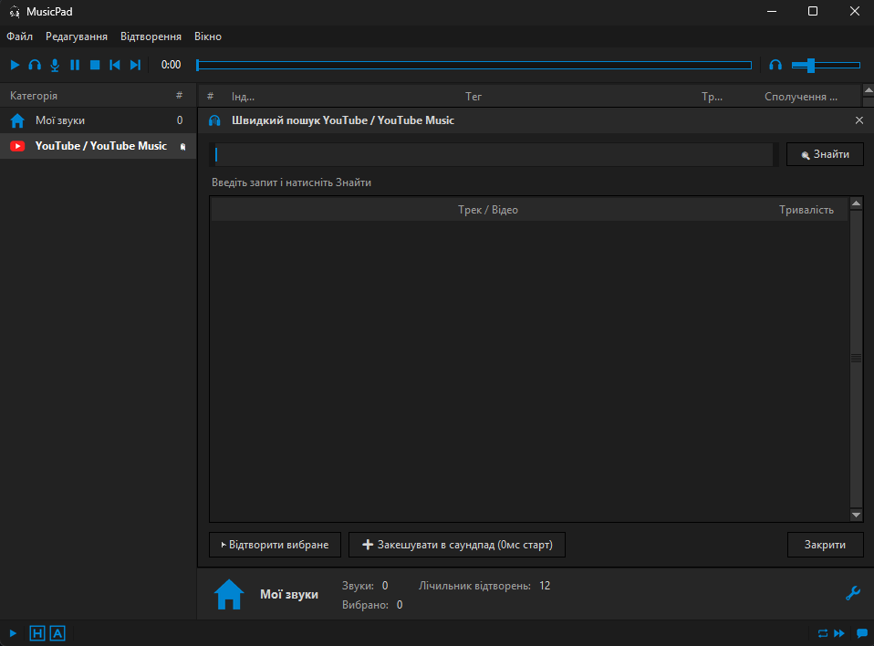

# MusicPad



MusicPad — Windows desktop-саундпад у стилі Soundpad, який відтворює локальні треки
або транслює YouTube Music безпосередньо у ваш **Цільовий мікрофон** (режим
**«Ін'єкція в мікрофон»**) або через віртуальний аудіокабель (режим **«Віртуальний кабель»**).

## Швидкий запуск (для користувачів)

1. Завантажте **`MusicPad.exe`** (або ZIP-архів) зі сторінки [**GitHub Releases**](../../releases/latest).
2. Запустіть файл — додаток працює одразу **«з коробки»**. Жодних додаткових компонентів (включно з FFmpeg) встановлювати не потрібно, FFmpeg та системний драйвер ін'єкції уже вшиті всередину виконуваного файлу.
3. **Два режими маршрутизації** (`Файл -> Налаштування -> Пристрої`):
   - **Ін'єкція в мікрофон (як у Soundpad)**: натисніть кнопку **«Встановити драйвер (UAC)»** у налаштуваннях пристроїв. MusicPad встановить власний системний **Драйвер MusicPad** (`MusicPadAPO`) на обраний мікрофон. У Discord, Telegram, іграх (CS2, Dota 2 тощо) залишайте ваш звичайний фізичний мікрофон — ін'єкція треку в потік мікрофона відбувається автоматично.
   - **Віртуальний кабель (VB-Cable)**: класичний запасний режим для програм з вимкненими аудіоефектами (`Signal Enhancements`) або WASAPI Exclusive/RAW. Обирайте `CABLE Input` у MusicPad та `CABLE Output` як мікрофон у цільовому застосунку ([VB-Audio Virtual Cable](https://vb-audio.com/Cable/)).

## Запуск із вихідного коду (для розробників)

1. Встановіть Python 3.10+, FFmpeg (`ffmpeg.exe` у `PATH`) та компілятор C++17 (MinGW-w64 UCRT64 або MSVC) для складання системного драйвера APO та спільного DSP-ядра.
2. Встановіть залежності та зберіть нативні модулі:
   ```powershell
   python -m pip install -r requirements.txt
   powershell -NoProfile -ExecutionPolicy Bypass -File native/build.ps1
   ```
3. Запустіть:
   ```powershell
   python main.py
   ```

### Складання власного автономного `.exe`:

```powershell
powershell -NoProfile -ExecutionPolicy Bypass -File native/build.ps1
pip install pyinstaller
pyinstaller --clean --noconfirm MusicPad.spec
```

Підтримуються `.mp3`, `.wav`, `.m4a`, `.flac`, `.aac`, `.ogg`, `.opus` та `.wma`.
Назви й тривалість локальних треків читаються через Mutagen. Для YouTube Music
можна ввести назву треку або URL.

## Примітки

- YouTube Music-режим використовує `ytmusicapi` для пошуку та `yt-dlp` для
  отримання прямого URL, тому файл не зберігається на диску.
- Для потокового декодування використовується FFmpeg (у готовому релізі `MusicPad.exe` він уже вшитий; при запуску безпосередньо з вихідного коду потрібен встановлений FFmpeg у системному `PATH`).
- Доступність форматів і пристроїв залежить від установлених кодеків та
  драйверів Windows.
- За замовчуванням закриття вікна ховає програму в системний трей. Це можна
  вимкнути прапорцем `Ховати в трей при закритті`. Для завершення роботи з
  трею використовуйте меню іконки MusicPad та пункт `Вийти`.
- **Обробка голосу та мікшування**:
  - Обидва режими маршрутизації використовують спільне C DSP-ядро (`musicpad_dsp.dll` / `musicpad_apo.dll`) у форматі `float32` з м'яким лімітером (`soft-knee`), що запобігає цифровому кліпінгу при одночасному мовленні та відтворенні треку.
  - Будь-який аудіотрек перед мікшуванням автоматично приводиться до нормалізованого `float32` у межах `[-1.0, 1.0]`, вирівнюється за кількістю каналів (автоматичне зведення стерео в моно при роботі з 1-канальним мікрофоном, зі збереженням чистого стерео для навушників) та частотою дискретизації (48 кГц), що гарантує відсутність шуму, шипіння або пошкодження буфера.
  - У режимі **«Ін'єкція в мікрофон»** мікшування треку з мікрофоном, підсилення (`gain`) та вимкнення голосу (`Mute Mic`) виконує системна APO безпосередньо в аудіографі Windows (`audiodg.exe`), а застосунок відкриває мікрофон лише коли увімкнено `Слухати мікрофон у навушниках` (для **Моніторингу**).
  - У режимі **«Віртуальний кабель»** застосунок читає мікрофон і подає змішаний сигнал у `CABLE Input` на нативній частоті дискретизації пристрою (зазвичай `48000 Hz`).
- Змішаний сигнал або сам трек можна одночасно слухати в навушниках (**Моніторинг**): у полі
  `Пристрій моніторингу / навушники` автоматично обираються ваші основні навушники/динаміки.
  За замовчуванням у навушниках відтворюється тільки трек (без відлуння власного голосу), а за потреби
  можна увімкнути прапорець `Слухати мікрофон у навушниках`. Зміна будь-якого пристрою або режиму маршрутизації
  застосовується миттєво на льоту без потреби перезапускати трек.
- **Функції програми та швидкий YouTube**:
  - **Миттєве перемикання треків і перемотування (Seek)**: подвійний клік або гаряча клавіша
    одразу перемикає трек без очікування завершення попереднього; повзунок `Позиція` дозволяє
    перемотувати трек у будь-яке місце (спільний кільцевий буфер драйвера очищується миттєво).
  - **Глобальні гарячі клавіші (працюють у грі та Discord)**: кожному треку у списку можна
    призначити власну клавішу (`⌨ Клавіша`, напр. `F1`–`F7`, `Num0`–`Num9`, `Alt+1`). Також діють
    глобальні клавіші: `F8` (Пауза/Продовжити), `F9` (Стоп), `F10` (Mute Mic).
  - **Швидкий пошук і кешування YouTube / YouTube Music**: кнопка `🔍 Пошук YT` відкриває
    вікно швидкого пошуку, а `➕ У список` (або автоматичне фонове кешування у `.cache/youtube/`)
    зберігає аудіо локально для миттєвого запуску (0 мс) за гарячою клавішею.
  - **Автозбереження**: вибрана папка, додані окремі файли (`+ Файли`), YouTube-треки, гарячі
    клавіші, режим маршрутизації та налаштування пристроїв зберігаються між запусками програми.

## Аварійне видалення Драйвера MusicPad вручну

Якщо ви видалили або перемістили `MusicPad.exe`, не натиснувши попередньо кнопку **«Видалити драйвер (UAC)»** у налаштуваннях, сам мікрофон продовжить працювати у штатному прозорому режимі (`passthrough`). Щоб повністю прибрати реєстрацію **Драйвера MusicPad** із системи вручну, запустіть **PowerShell від імені Адміністратора** та виконайте:

```powershell
# Варіант 1: через вбудований CLI-ключ MusicPad
.\MusicPad.exe --driver uninstall

# або з вихідного коду:
python main.py --driver uninstall
```

```powershell
# Варіант 2: безпосередньо через PowerShell (навіть якщо MusicPad.exe вже видалено)
$manifest = "$env:ProgramData\MusicPad\driver_backup.json"
if (Test-Path $manifest) {
    $cfg = Get-Content $manifest -Raw | ConvertFrom-Json
    $fxPath = "HKLM:\SOFTWARE\Microsoft\Windows\CurrentVersion\MMDevices\Audio\Capture\$($cfg.endpoint_guid)\FxProperties"
    if (Test-Path $fxPath) {
        if ($cfg.prev_efx) {
            Set-ItemProperty -Path $fxPath -Name "{d04e05a6-594b-4fb6-a80d-01af5eed7d1d},7" -Value $cfg.prev_efx
        } else {
            Remove-ItemProperty -Path $fxPath -Name "{d04e05a6-594b-4fb6-a80d-01af5eed7d1d},7" -ErrorAction SilentlyContinue
        }
    }
}
Remove-Item -Path "HKLM:\SOFTWARE\Classes\CLSID\{8B45E712-94C3-4D01-B956-5E46F9C3A202}" -Recurse -Force -ErrorAction SilentlyContinue
Remove-Item -Path "HKLM:\AudioEngine\AudioProcessingObjects\{8B45E712-94C3-4D01-B956-5E46F9C3A202}" -Recurse -Force -ErrorAction SilentlyContinue
Restart-Service Audiosrv -Force
Remove-Item -Path "$env:ProgramData\MusicPad" -Recurse -Force -ErrorAction SilentlyContinue
```
