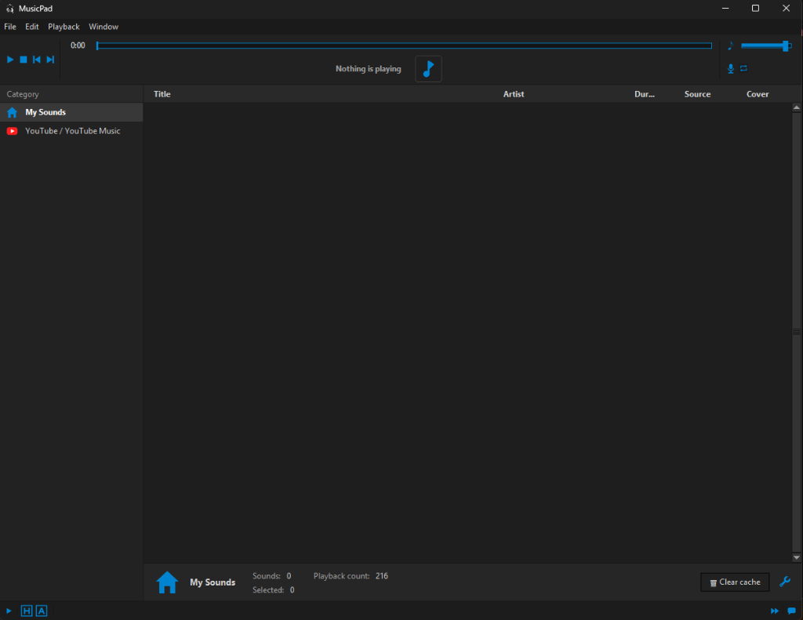

[🇺🇦 Українська версія](README.ua.md) | **English**

# MusicPad



**MusicPad** is a modern Windows desktop soundpad in the spirit of Soundpad. It plays local audio files and streams tracks from YouTube / YouTube Music directly into your microphone or via a virtual audio cable. Your teammates and friends in Discord, Telegram, games (CS2, Dota 2), and live streams hear clean, high-quality audio along with your voice with minimal latency.

---

## Quick Start (for Users)

1. Download **`MusicPad.exe`** (or the ZIP bundle) from [**GitHub Releases**](../../releases/latest).
2. Run the application — it is fully portable and works **out of the box**. All necessary dependencies (FFmpeg, injection driver, DSP libraries) are embedded.
3. **Select your routing mode** (`File ➔ Settings ➔ Devices`):
   - **Microphone Injection (Soundpad-style)**: Click **"Install Driver (UAC)"**. MusicPad registers its system audio driver (`MusicPadAPO`) onto your selected physical microphone. In Discord, games, and voice apps, keep your normal microphone selected — audio tracks are blended into your mic feed automatically.
   - **Virtual Cable (VB-Cable)**: Fallback mode for applications without Windows audio enhancement support (WASAPI Exclusive/RAW). Select `CABLE Input` in MusicPad and `CABLE Output` as your microphone in the target voice application ([VB-Audio Virtual Cable](https://vb-audio.com/Cable/)).

---

## Key Features

### 🎙️ Microphone DSP & Audio Clarity
- **Optional Neural Noise Suppression (DeepFilterNet)**: Intelligent real-time noise suppression powered by DeepFilterNet to eliminate fan noise, background hum, and keyboard clicks, with an adjustable Wet/Dry balance slider (0–100%).
- **Optional White Noise Removal**: Combination of a DC offset high-pass filter (35 Hz) and a smooth downward expander (-55 dBFS) that zeroes background hiss during speech pauses.
- **Voice Boost**: Calibrated linear microphone amplification from 0 to +24 dB with a protective soft-knee limiter (-1.0 dBFS) preventing clipping and distortion.
- **Monitoring**: Real-time headphone monitoring for tracks and optional mic feedback without delay.
- **"Mute for Others" Button**: Instantly mutes the track for voice chat listeners while keeping it audible in your own headphones.

### 🔍 YouTube & YouTube Music
- **Fast Search & Caching**: Search tracks by title or direct URL with immediate playback and background caching in `.cache/`.
- **YouTube Priority (Search by Title)**: Independent toggle routing queries directly through YouTube (`ytsearch`) — ideal for finding memes, sound effects, and exact video titles without music catalog restrictions.
- **Filtering & Album Playback**: Search filter modes ("All results", "No albums", "Albums only"), adjustable track result count slider (5 to 35), and sequential album autoplay queue.
- **"Clear Cache" Button**: One-click cleanup of downloaded cache files in "My Sounds" to free disk space.

### ⌨️ Controls & Workflow
- **Special Hotkeys**: Streamlined table of essential actions (*Pause*, *Stop*, *Copy*, *Paste*, *Delete*, *Search*) with interactive key capture and conflict detection.
- **Global Track Hotkeys**: Assign dedicated keys to individual sound tracks for instant triggering while in-game.
- **Convenience**: Dark and light themes, "Hide to tray on close", and full state persistence between sessions.

---

## Running from Source (for Developers)

1. Ensure Python 3.10+, FFmpeg in your `PATH`, and a C++17 compiler (MinGW-w64 UCRT64 or MSVC) are installed.
2. Install dependencies and build native libraries:
   ```powershell
   python -m pip install -r requirements.txt
   powershell -NoProfile -ExecutionPolicy Bypass -File native/build.ps1
   ```
3. Run:
   ```powershell
   python main.py
   ```

### Building the Standalone `.exe`:
```powershell
pip install pyinstaller
pyinstaller --clean --noconfirm MusicPad.spec
```

---

## Manual Driver Cleanup (Emergency Uninstall)

If the application was removed before clicking **"Uninstall Driver (UAC)"** in Settings, run **PowerShell as Administrator**:

```powershell
# Method 1: Via built-in CLI
.\MusicPad.exe --driver uninstall

# Method 2: Direct registry & service cleanup
$manifest = "$env:ProgramData\MusicPad\driver_backup.json"
if (Test-Path $manifest) {
    $cfg = Get-Content $manifest -Raw | ConvertFrom-Json
    $fxPath = "HKLM:\SOFTWARE\Microsoft\Windows\CurrentVersion\MMDevices\Audio\Capture\$($cfg.endpoint_guid)\FxProperties"
    if (Test-Path $fxPath) {
        if ($cfg.prev_efx) {
            Set-ItemProperty -Path $fxPath -Name "{d04e05a6-594b-4fb6-a80d-01af5eed7d1d},7" -Value $cfg.prev_efx
        } else {
            Remove-ItemProperty -Path $fxPath -Name "{d04e05a6-594b-4fb6-a80d-01af5eed7d1d},7" -ErrorAction SilentlyContinue
        }
    }
}
Remove-Item -Path "HKLM:\SOFTWARE\Classes\CLSID\{8B45E712-94C3-4D01-B956-5E46F9C3A202}" -Recurse -Force -ErrorAction SilentlyContinue
Remove-Item -Path "HKLM:\AudioEngine\AudioProcessingObjects\{8B45E712-94C3-4D01-B956-5E46F9C3A202}" -Recurse -Force -ErrorAction SilentlyContinue
Restart-Service Audiosrv -Force
Remove-Item -Path "$env:ProgramData\MusicPad" -Recurse -Force -ErrorAction SilentlyContinue
```
