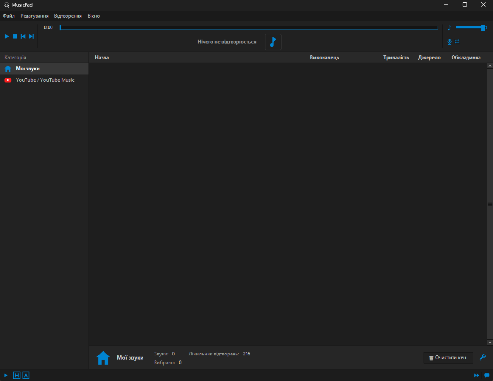

**Українська** | [🇬🇧 English version](README.md)

# MusicPad



**MusicPad** — сучасний Windows desktop-саундпад у стилі Soundpad, який відтворює локальні аудіофайли та транслює треки з YouTube / YouTube Music безпосередньо у ваш мікрофон або через віртуальний аудіокабель. Співрозмовники в Discord, Telegram, іграх (CS2, Dota 2) та стримах чують якісний звук разом із вашим голосом із мінімальною затримкою.

---

## Швидкий запуск (для користувачів)

1. Завантажте **`MusicPad-windows-x64.zip`** зі сторінки [**GitHub Releases**](../../releases/latest).
2. Розпакуйте архів у будь-яку теку з правом запису (наприклад, Робочий стіл, Документи чи `D:\Apps` — **не** розпаковуйте в `C:\Program Files` без прав запису).
3. Запустіть **`MusicPad.exe`** всередині розпакованої теки `MusicPad` — програма працює портативно **«з коробки»**. Усі необхідні компоненти (FFmpeg, системний драйвер ін'єкції та DSP-бібліотеки) уже вбудовані в `_internal/`.
   > **Оновлення програми**: Щоб оновити MusicPad, просто розпакуйте новий ZIP-архів поверх вашої наявної теки `MusicPad`. Ваші налаштування, списки звуків та кеш у `.cache/` повністю збережуться.
4. **Оберіть режим маршрутизації** (`Файл ➔ Налаштування ➔ Пристрої`):
   - **Ін'єкція в мікрофон (як у Soundpad)**: натисніть **«Встановити драйвер (UAC)»**. MusicPad встановить системний драйвер (`MusicPadAPO`) на обраний фізичний мікрофон. У Discord, іграх та месенджерах виберіть ваш звичайний мікрофон — звук треків додається у потік автоматично.
   - **Віртуальний кабель (VB-Cable)**: запасний режим для програм без підтримки аудіоефектів Windows (Exclusive/RAW). Оберіть `CABLE Input` у MusicPad та `CABLE Output` як мікрофон у цільовому додатку ([VB-Audio Virtual Cable](https://vb-audio.com/Cable/)).

---

## Ключові можливості

### 🎙️ Обробка мікрофона та чистота звуку
- **Опціональне нейромережеве шумозаглушення (DeepFilterNet)**: інтелектуальне придушення фонового шуму, кліків клавіатури та вентиляторів із регульованим балансом прямого та обробленого сигналу (Wet/Dry 0–100%).
- **Опціональне усунення білого шуму**: комбінація фільтра постійної складової (High-Pass 35 Гц) та плавного експандера тиші (-55 dBFS), що усуває фонове шипіння мікрофона під час пауз у мовленні.
- **Підсилення голосу (Voice Boost)**: каліброване лінійне підсилення мікрофона від 0 до +24 дБ із захисним лімітером (-1.0 dBFS), який запобігає перевантаженню та кліпінгу.
- **Моніторинг**: можливість окремо чути трек і власний голос у навушниках без затримки.
- **Кнопка «Мут для інших»**: швидке приглушення треку для співрозмовників у мікрофоні при збереженні чутності у власних навушниках.

### 🔍 YouTube та YouTube Music
- **Швидкий пошук і кешування**: пошук треків за назвою чи прямим посиланням із миттєвим завантаженням та фоновим кешуванням у `.cache/`.
- **Пріоритет YouTube (пошук за назвою)**: незалежний перемикач для прямого пошуку роликів на YouTube (`ytsearch`) — ідеально для пошуку мемів, звукових ефектів та відео за точною назвою без обмежень музичних каталогів.
- **Фільтрація та альбоми**: фільтри видачі («Всі результати», «Без альбомів», «Тільки альбоми»), налаштування ліміту видачі треків (від 5 до 35) та автоматичне послідовне відтворення альбомів.
- **Кнопка «Очистити кеш»**: безпечне видалення завантажених файлів у категорії «Мої звуки» в один клік для звільнення диску.

### ⌨️ Керування та інтерфейс
- **Спеціальні гарячі клавіші**: зручна таблиця ключових дій (*Пауза*, *Стоп*, *Копіювати*, *Вставити*, *Видалити*, *Пошук*) з інтерактивним призначенням натисканням клавіш та захистом від конфліктів.
- **Глобальні клавіші для треків**: призначення індивідуальних кнопок кожному звуку для миттєвого запуску під час гри.
- **Зручність**: темна і світла теми, згортання в системний трей при закритті (`Ховати в трей при закритті`) та повне збереження налаштувань між запусками.

---

## Запуск із вихідного коду (для розробників)

1. Встановіть Python 3.10+, FFmpeg у `PATH` та C++17 компілятор (MinGW-w64 UCRT64 або MSVC):
2. Встановіть залежності та зберіть нативні бібліотеки:
   ```powershell
   python -m pip install -r requirements.txt
   powershell -NoProfile -ExecutionPolicy Bypass -File native/build.ps1
   ```
3. Запустіть програму:
   ```powershell
   python main.py
   ```

### Збірка виконуваного `.exe`:
```powershell
pip install pyinstaller
pyinstaller --clean --noconfirm MusicPad.spec
```

---

## Аварійне видалення Драйвера MusicPad вручну

Якщо додаток було видалено без попереднього натискання кнопки **«Видалити драйвер (UAC)»**, запустіть **PowerShell від імені Адміністратора**:

```powershell
# Варіант 1: через вбудований CLI
.\MusicPad.exe --driver uninstall

# Варіант 2: якщо сам MusicPad.exe уже видалено
$manifest = "$env:ProgramData\MusicPad\driver_backup.json"
if (Test-Path $manifest) {
    $cfg = Get-Content $manifest -Raw | ConvertFrom-Json
    $fxPath = "HKLM:\SOFTWARE\Microsoft\Windows\CurrentVersion\MMDevices\Audio\Capture\$($cfg.endpoint_guid)\FxProperties"
    if (Test-Path $fxPath) {
        if ($cfg.prev_efx) {
            Set-ItemProperty -Path $fxPath -Name "{d04e05a6-594b-4fb6-a80d-01af5eed7d1d},7" -Value $cfg.prev_efx
        } else {
            Remove-ItemProperty -Path $fxPath -Name "{d04e05a6-594b-4fb6-a80d-01af5eed7d1d},7" -ErrorAction SilentlyContinue
        }
    }
}
Remove-Item -Path "HKLM:\SOFTWARE\Classes\CLSID\{8B45E712-94C3-4D01-B956-5E46F9C3A202}" -Recurse -Force -ErrorAction SilentlyContinue
Remove-Item -Path "HKLM:\AudioEngine\AudioProcessingObjects\{8B45E712-94C3-4D01-B956-5E46F9C3A202}" -Recurse -Force -ErrorAction SilentlyContinue
Restart-Service Audiosrv -Force
Remove-Item -Path "$env:ProgramData\MusicPad" -Recurse -Force -ErrorAction SilentlyContinue
```
